<p align="center">
  
</p>

<p align="center">
  
</p>

```text
 ┌──────────────────────────────────────────────────────────────┐
 │  TRANSMISSION LOG 0x01 ─ ORIGIN: MELBOURNE, EARTH            │
 ├──────────────────────────────────────────────────────────────┤
 │  SUBJECT ......... TIMOTHY ITAYI                             │
 │  CLASS ........... IAM / IT SUPPORT OPERATIVE                │
 │  MISSION ......... Keep the right beings on the right        │
 │                    systems, and nobody else.                 │
 │  STATUS .......... OPEN TO JUNIOR IAM · HELP DESK · CLOUD    │
 └──────────────────────────────────────────────────────────────┘
```


### `> SCANNING SECTOR: IAM & IT LABS`

| Signal | Project | What it does |
|:--:|---|---|
| 🛸 | **[Okta IAM Lab](https://github.com/Timothy-itayi/okta-iam-lifecycle-lab)** | Joiner / mover / leaver lifecycle for a sample app (Rostr): SSO, group-based access, automated deprovisioning |
| 📡 | **[M365 / Intune Help Desk Lab](https://github.com/Timothy-itayi/m365-intune-helpdesk-lab)** | Device enrolment, compliance policies, and realistic L1/L2 ticket scenarios |
| 🛰️ | **[Azure AD Help Desk Lab](https://github.com/Timothy-itayi/operation-homelabs)** | Automated user provisioning with PowerShell, AD structure, and password reset workflows |


### `> SECONDARY SIGNALS DETECTED`

```text
 [■] RESTOCK ....... live iOS app: inventory lists → supplier emails
 [■] PITWALL ....... F1 data dashboard
 [■] GAMES ......... cassette-futurist narrative + physics prototypes
```


### `> ONBOARD SYSTEMS`

<p align="left">
  
  <br/>
  
</p>

```text
 IDENTITY ..... Okta · Entra ID · Active Directory · SSO / SAML / SCIM
 ENDPOINT ..... Intune · Microsoft 365
 CLOUD ........ Azure · Cloudflare Workers
 SCRIPTING .... PowerShell · TypeScript
```


### `> SIGNAL STRENGTH`

<p align="center">
  
  
</p>


### `> OPEN A CHANNEL`

```text
 > TRANSMIT VIA LINKEDIN ........ linkedin.com/in/timothy-itayi-ab8754138
 > RESPONSE TIME ................ < 1 Earth day
```

<p align="center">
  <a href="https://www.linkedin.com/in/timothy-itayi-ab8754138/">
    
  </a>
</p>

<p align="center"><sub><code>END OF TRANSMISSION ▮</code></sub></p>
